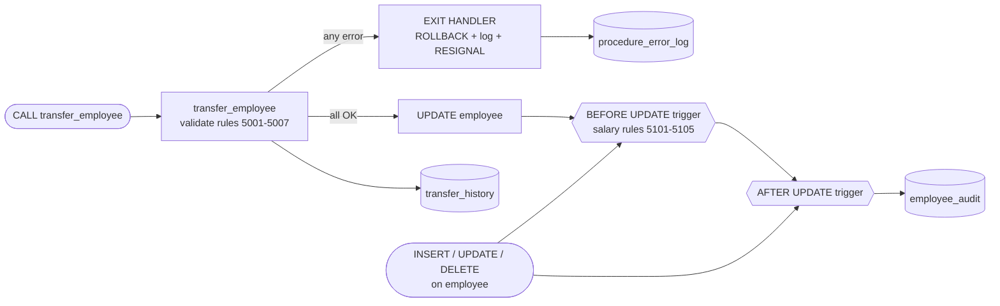

<div align="center">


<table>
<tr><th align="left">Name</th><td>Ritesh Vishwakarma</td><th align="left">UID</th><td><code>25LBCS3192</code></td></tr>
<tr><th align="left">Experiment No.</th><td>06</td><th align="left">SQL Script</th><td><a href="procedures_triggers.sql"></a></td></tr>
<tr><th align="left">Experiment Title</th><td colspan="3">Stored Procedure, Triggers and Edge-Case Testing</td></tr>
</table>

</div>


## $\color{#9C6610}{\textsf{Aim}}$

> [!NOTE]
> To create a stored procedure **`transfer_employee(emp_id, new_dept_id)`** with **validation and error handling**, to implement **triggers for salary validation and audit logging**, and to **test edge cases**.


## $\color{#9C6610}{\textsf{Software Required}}$

- MySQL Server 8.0 or later
- MySQL Workbench or the MySQL command-line client


## $\color{#9C6610}{\textsf{Files}}$

| File | Description |
|---|---|
| [`procedures_triggers.sql`](procedures_triggers.sql) | Tables, procedure, triggers and all test cases |
| [`company_queries.sql`](company_queries.sql) | Creates and fills `company_db` (prerequisite) |
| `Exp_6.md` | This lab record |

**How to run:**

```bash
mysql -u root -p -t < company_queries.sql          # creates the schema and data
mysql -u root -p -t --force < procedures_triggers.sql              # runs Experiment 6
```

> `--force` lets the script continue after the **intentional** errors in the test cases. The tests change employee data, so re-run the Experiment 3 script to reset it. Outputs were captured on **MySQL 8.0.46**.


## $\color{#9C6610}{\textsf{1. Theory}}$

### 1.1 Stored Procedures

A **stored procedure** is a named block of SQL statements stored in the database and run with `CALL`. It can take `IN`, `OUT` and `INOUT` parameters, and use variables, `IF`, loops, transactions and error handlers.

| Benefit | How it is used here |
|---|---|
| Business rules in one place | All transfer rules live inside `transfer_employee` |
| Atomicity | `START TRANSACTION … COMMIT`, with `ROLLBACK` on error |
| Security | Users can be granted `EXECUTE` on the procedure without `UPDATE` on the table |
| Less network traffic | Several statements run on the server in one call |

### 1.2 Error Handling in MySQL

| Statement | Purpose |
|---|---|
| `SIGNAL SQLSTATE '45000' SET MESSAGE_TEXT = …, MYSQL_ERRNO = …` | Raise a custom error (`45000` = user-defined exception) |
| `DECLARE EXIT HANDLER FOR SQLEXCEPTION BEGIN … END` | Run cleanup code when any error occurs, then leave the procedure |
| `DECLARE CONTINUE HANDLER FOR …` | Handle the error and keep going |
| `GET DIAGNOSTICS CONDITION 1 v = MYSQL_ERRNO, …` | Read the error number, SQLSTATE and message inside a handler |
| `RESIGNAL` | Re-raise the caught error to the caller, unchanged |

### 1.3 Triggers

A **trigger** is code that runs **automatically** when a row is inserted, updated or deleted.

| Timing | Typical use | Can see |
|---|---|---|
| `BEFORE INSERT / UPDATE` | **Validate** or modify the new values. A `SIGNAL` cancels the statement. | `NEW` (and `OLD` for UPDATE) |
| `AFTER INSERT / UPDATE / DELETE` | **Audit logging** and changes to other tables | `NEW` / `OLD` (read-only) |
| `BEFORE DELETE` | Block deletions that break business rules | `OLD` |

Triggers are `FOR EACH ROW`. A statement that touches 10 rows fires the trigger 10 times, and if any one of them fails, the **entire statement is rolled back**.

### 1.4 Design of This Experiment



### 1.5 Custom Error Codes

| Code | Raised by | Rule |
|---|---|---|
| 5001 | Procedure | `emp_id` and `new_dept_id` are required (NULL or blank) |
| 5002 | Procedure | Employee does not exist |
| 5003 | Procedure | Department does not exist |
| 5004 | Procedure | Employee is already in that department |
| 5005 | Procedure | Employee is the head of a department |
| 5006 | Procedure | Employee is the Lead of an **Ongoing** project |
| 5007 | Procedure | Employee still has direct reports |
| 5101 | Trigger | Salary below ₹15,000 |
| 5102 | Trigger | Salary above ₹5,00,000 |
| 5103 | Trigger | Commission more than 50% of salary |
| 5104 | Trigger | Raise of more than 30% in one update |
| 5105 | Trigger | Salary reduction |
| 5106 | Trigger | Deleting a department head |


## $\color{#9C6610}{\textsf{2. Implementation}}$

### 2.1 Supporting Tables

```sql
-- Audit trail written by the triggers (no FK, so history survives deletes)
CREATE TABLE employee_audit (
    audit_id         INT AUTO_INCREMENT PRIMARY KEY,
    emp_id           INT          NOT NULL,
    action           ENUM('INSERT','UPDATE','DELETE') NOT NULL,
    old_dept         CHAR(3),
    new_dept         CHAR(3),
    old_salary       DECIMAL(10,2),
    new_salary       DECIMAL(10,2),
    old_designation  VARCHAR(50),
    new_designation  VARCHAR(50),
    changed_by       VARCHAR(100) NOT NULL,
    changed_at       TIMESTAMP    NOT NULL DEFAULT CURRENT_TIMESTAMP
);

-- History of successful transfers written by the procedure
CREATE TABLE transfer_history (
    transfer_id      INT AUTO_INCREMENT PRIMARY KEY,
    emp_id           INT     NOT NULL,
    from_dept        CHAR(3) NOT NULL,
    to_dept          CHAR(3) NOT NULL,
    old_manager_id   INT,
    new_manager_id   INT,
    transferred_by   VARCHAR(100) NOT NULL,
    transferred_at   TIMESTAMP NOT NULL DEFAULT CURRENT_TIMESTAMP
);

-- Failed procedure calls captured by the error handler
CREATE TABLE procedure_error_log (
    log_id           INT AUTO_INCREMENT PRIMARY KEY,
    proc_name        VARCHAR(64) NOT NULL,
    emp_id           INT,
    new_dept_id      VARCHAR(10),
    sql_state        CHAR(5),
    error_no         INT,
    error_message    VARCHAR(255),
    logged_at        TIMESTAMP NOT NULL DEFAULT CURRENT_TIMESTAMP
);
```

### 2.2 Stored Procedure `transfer_employee`

```sql
DELIMITER $$

CREATE PROCEDURE transfer_employee(IN p_emp_id INT, IN p_new_dept_id VARCHAR(10))
BEGIN
    DECLARE v_old_dept   CHAR(3);
    DECLARE v_old_mgr    INT;
    DECLARE v_new_mgr    INT;
    DECLARE v_emp_name   VARCHAR(61);
    DECLARE v_count      INT DEFAULT 0;
    DECLARE v_msg        VARCHAR(255);
    -- variables for the error handler
    DECLARE v_state      CHAR(5);
    DECLARE v_errno      INT;
    DECLARE v_errmsg     VARCHAR(255);

    -- Error handling: on ANY error, roll back, log the failure, re-raise it to the caller
    DECLARE EXIT HANDLER FOR SQLEXCEPTION
    BEGIN
        GET DIAGNOSTICS CONDITION 1
            v_state  = RETURNED_SQLSTATE,
            v_errno  = MYSQL_ERRNO,
            v_errmsg = MESSAGE_TEXT;
        ROLLBACK;
        INSERT INTO procedure_error_log (proc_name, emp_id, new_dept_id, sql_state, error_no, error_message)
        VALUES ('transfer_employee', p_emp_id, p_new_dept_id, v_state, v_errno, v_errmsg);
        RESIGNAL;
    END;

    -- Normalise input: ' d05 ' -> 'D05'
    SET p_new_dept_id = UPPER(TRIM(p_new_dept_id));

    -- Rule 5001: required parameters
    IF p_emp_id IS NULL OR p_new_dept_id IS NULL OR p_new_dept_id = '' THEN
        SIGNAL SQLSTATE '45000'
            SET MESSAGE_TEXT = 'emp_id and new_dept_id are required', MYSQL_ERRNO = 5001;
    END IF;

    START TRANSACTION;

    -- Rule 5002: employee must exist (row is locked until COMMIT/ROLLBACK)
    SELECT dept_id, manager_id, CONCAT(first_name, ' ', last_name)
      INTO v_old_dept, v_old_mgr, v_emp_name
      FROM employee
     WHERE emp_id = p_emp_id
       FOR UPDATE;

    IF v_old_dept IS NULL THEN
        SET v_msg = CONCAT('Employee ', p_emp_id, ' does not exist');
        SIGNAL SQLSTATE '45000' SET MESSAGE_TEXT = v_msg, MYSQL_ERRNO = 5002;
    END IF;

    -- Rule 5003: target department must exist
    IF NOT EXISTS (SELECT 1 FROM department WHERE dept_id = p_new_dept_id) THEN
        SET v_msg = CONCAT('Department ', p_new_dept_id, ' does not exist');
        SIGNAL SQLSTATE '45000' SET MESSAGE_TEXT = v_msg, MYSQL_ERRNO = 5003;
    END IF;

    -- Rule 5004: must be a different department
    IF v_old_dept = p_new_dept_id THEN
        SET v_msg = CONCAT(v_emp_name, ' is already in department ', p_new_dept_id);
        SIGNAL SQLSTATE '45000' SET MESSAGE_TEXT = v_msg, MYSQL_ERRNO = 5004;
    END IF;

    -- Rule 5005: department heads cannot be transferred
    IF EXISTS (SELECT 1 FROM department WHERE manager_id = p_emp_id) THEN
        SET v_msg = CONCAT(v_emp_name, ' heads a department; appoint a new head first');
        SIGNAL SQLSTATE '45000' SET MESSAGE_TEXT = v_msg, MYSQL_ERRNO = 5005;
    END IF;

    -- Rule 5006: Leads of ongoing projects cannot be transferred
    IF EXISTS (SELECT 1
                 FROM works_on w
                 JOIN project p ON p.proj_id = w.proj_id
                WHERE w.emp_id = p_emp_id AND w.role = 'Lead' AND p.status = 'Ongoing') THEN
        SET v_msg = CONCAT(v_emp_name, ' leads an ongoing project; hand over the project first');
        SIGNAL SQLSTATE '45000' SET MESSAGE_TEXT = v_msg, MYSQL_ERRNO = 5006;
    END IF;

    -- Rule 5007: employees with direct reports cannot be transferred
    SELECT COUNT(*) INTO v_count FROM employee WHERE manager_id = p_emp_id;
    IF v_count > 0 THEN
        SET v_msg = CONCAT(v_emp_name, ' has ', v_count, ' direct report(s); reassign them first');
        SIGNAL SQLSTATE '45000' SET MESSAGE_TEXT = v_msg, MYSQL_ERRNO = 5007;
    END IF;

    -- All checks passed: move the employee and report to the new department's head
    SELECT manager_id INTO v_new_mgr FROM department WHERE dept_id = p_new_dept_id;

    UPDATE employee
       SET dept_id = p_new_dept_id,
           manager_id = v_new_mgr
     WHERE emp_id = p_emp_id;

    INSERT INTO transfer_history (emp_id, from_dept, to_dept, old_manager_id, new_manager_id, transferred_by)
    VALUES (p_emp_id, v_old_dept, p_new_dept_id, v_old_mgr, v_new_mgr, CURRENT_USER());

    COMMIT;

    SELECT CONCAT('SUCCESS: ', v_emp_name, ' transferred from ', v_old_dept,
                  ' to ', p_new_dept_id, ' (new manager: ', v_new_mgr, ')') AS result;
END $$

DELIMITER ;
```

**Key points:**
- **Validation** happens before any change, in a fixed order. The first rule that fails stops the procedure with a clear message and a unique error number.
- `SELECT … FOR UPDATE` **locks** the employee row, so two sessions cannot transfer the same person at the same time.
- The **EXIT HANDLER** catches every error, whether from a `SIGNAL`, a constraint or a trigger. It reads the error with `GET DIAGNOSTICS`, runs `ROLLBACK`, writes to `procedure_error_log`, and re-raises the original error with `RESIGNAL`.
- On success, the employee's manager is set to the head of the new department, and the move is recorded in `transfer_history`.

### 2.3 Triggers

```sql
DELIMITER $$

-- Helper procedure shared by the INSERT and UPDATE triggers
CREATE PROCEDURE validate_salary(IN p_salary DECIMAL(10,2), IN p_commission DECIMAL(10,2))
BEGIN
    IF p_salary < 15000 THEN
        SIGNAL SQLSTATE '45000'
            SET MESSAGE_TEXT = 'Salary cannot be below Rs 15,000 per month', MYSQL_ERRNO = 5101;
    END IF;
    IF p_salary > 500000 THEN
        SIGNAL SQLSTATE '45000'
            SET MESSAGE_TEXT = 'Salary cannot exceed Rs 5,00,000 per month', MYSQL_ERRNO = 5102;
    END IF;
    IF p_commission IS NOT NULL AND p_commission > 0.5 * p_salary THEN
        SIGNAL SQLSTATE '45000'
            SET MESSAGE_TEXT = 'Commission cannot exceed 50% of salary', MYSQL_ERRNO = 5103;
    END IF;
END $$

-- 1. Salary validation on INSERT
CREATE TRIGGER trg_employee_before_insert
BEFORE INSERT ON employee
FOR EACH ROW
BEGIN
    CALL validate_salary(NEW.salary, NEW.commission);
END $$

-- 2. Salary validation on UPDATE (limits + no big jumps + no cuts)
CREATE TRIGGER trg_employee_before_update
BEFORE UPDATE ON employee
FOR EACH ROW
BEGIN
    DECLARE v_msg VARCHAR(255);

    CALL validate_salary(NEW.salary, NEW.commission);

    IF NEW.salary > OLD.salary * 1.30 THEN
        SET v_msg = CONCAT('Raise for employee ', OLD.emp_id, ' is ',
                           ROUND((NEW.salary - OLD.salary) * 100 / OLD.salary, 1),
                           '%; maximum allowed is 30%');
        SIGNAL SQLSTATE '45000' SET MESSAGE_TEXT = v_msg, MYSQL_ERRNO = 5104;
    END IF;

    IF NEW.salary < OLD.salary THEN
        SET v_msg = CONCAT('Salary of employee ', OLD.emp_id, ' cannot be reduced (',
                           OLD.salary, ' -> ', NEW.salary, ')');
        SIGNAL SQLSTATE '45000' SET MESSAGE_TEXT = v_msg, MYSQL_ERRNO = 5105;
    END IF;
END $$

-- 3. Protect department heads from deletion
CREATE TRIGGER trg_employee_before_delete
BEFORE DELETE ON employee
FOR EACH ROW
BEGIN
    IF EXISTS (SELECT 1 FROM department WHERE manager_id = OLD.emp_id) THEN
        SIGNAL SQLSTATE '45000'
            SET MESSAGE_TEXT = 'Cannot delete a department head; appoint a new head first',
                MYSQL_ERRNO = 5106;
    END IF;
END $$

-- 4. Audit logging: INSERT
CREATE TRIGGER trg_employee_after_insert
AFTER INSERT ON employee
FOR EACH ROW
BEGIN
    INSERT INTO employee_audit (emp_id, action, new_dept, new_salary, new_designation, changed_by)
    VALUES (NEW.emp_id, 'INSERT', NEW.dept_id, NEW.salary, NEW.designation, CURRENT_USER());
END $$

-- 5. Audit logging: UPDATE (only when a tracked column really changed)
CREATE TRIGGER trg_employee_after_update
AFTER UPDATE ON employee
FOR EACH ROW
BEGIN
    IF NOT (OLD.dept_id     <=> NEW.dept_id)
    OR NOT (OLD.salary      <=> NEW.salary)
    OR NOT (OLD.designation <=> NEW.designation) THEN
        INSERT INTO employee_audit (emp_id, action, old_dept, new_dept, old_salary, new_salary,
                                    old_designation, new_designation, changed_by)
        VALUES (NEW.emp_id, 'UPDATE', OLD.dept_id, NEW.dept_id, OLD.salary, NEW.salary,
                OLD.designation, NEW.designation, CURRENT_USER());
    END IF;
END $$

-- 6. Audit logging: DELETE
CREATE TRIGGER trg_employee_after_delete
AFTER DELETE ON employee
FOR EACH ROW
BEGIN
    INSERT INTO employee_audit (emp_id, action, old_dept, old_salary, old_designation, changed_by)
    VALUES (OLD.emp_id, 'DELETE', OLD.dept_id, OLD.salary, OLD.designation, CURRENT_USER());
END $$

DELIMITER ;
```

| Trigger | Timing | Event | Purpose |
|---|---|---|---|
| `trg_employee_before_insert` | BEFORE | INSERT | Salary and commission limits |
| `trg_employee_before_update` | BEFORE | UPDATE | Limits, maximum 30% raise, no salary cut |
| `trg_employee_before_delete` | BEFORE | DELETE | Protect department heads |
| `trg_employee_after_insert` | AFTER | INSERT | Audit the new row |
| `trg_employee_after_update` | AFTER | UPDATE | Audit changes to dept, salary or designation |
| `trg_employee_after_delete` | AFTER | DELETE | Audit the deleted row |

`validate_salary` is a helper procedure called by **both** BEFORE triggers, so the salary rules are written only once.


## $\color{#9C6610}{\textsf{3. Verifying the Objects}}$

#### D1. Stored routines in company_db.

```sql
SELECT ROUTINE_NAME, ROUTINE_TYPE, CREATED IS NOT NULL AS created
FROM information_schema.ROUTINES
WHERE ROUTINE_SCHEMA = 'company_db'
ORDER BY ROUTINE_NAME;
```

**Output:**

```
+-------------------+--------------+---------+
| ROUTINE_NAME      | ROUTINE_TYPE | created |
+-------------------+--------------+---------+
| transfer_employee | PROCEDURE    |       1 |
| validate_salary   | PROCEDURE    |       1 |
+-------------------+--------------+---------+
2 rows in set
```

#### D2. Triggers on the employee table.

```sql
SELECT TRIGGER_NAME, ACTION_TIMING AS timing, EVENT_MANIPULATION AS event, EVENT_OBJECT_TABLE AS on_table
FROM information_schema.TRIGGERS
WHERE TRIGGER_SCHEMA = 'company_db'
ORDER BY ACTION_TIMING DESC, EVENT_MANIPULATION;
```

**Output:**

```
+----------------------------+--------+--------+----------+
| TRIGGER_NAME               | timing | event  | on_table |
+----------------------------+--------+--------+----------+
| trg_employee_after_insert  | AFTER  | INSERT | employee |
| trg_employee_after_update  | AFTER  | UPDATE | employee |
| trg_employee_after_delete  | AFTER  | DELETE | employee |
| trg_employee_before_insert | BEFORE | INSERT | employee |
| trg_employee_before_update | BEFORE | UPDATE | employee |
| trg_employee_before_delete | BEFORE | DELETE | employee |
+----------------------------+--------+--------+----------+
6 rows in set
```


## $\color{#9C6610}{\textsf{4. Testing the Procedure}}$

#### T1. Transfer Arjun (105) from Engineering (D01) to Finance (D03).

```sql
SELECT emp_id, first_name, dept_id, manager_id FROM employee WHERE emp_id = 105;
CALL transfer_employee(105, 'D03');
SELECT emp_id, first_name, dept_id, manager_id FROM employee WHERE emp_id = 105;
SELECT transfer_id, emp_id, from_dept, to_dept, old_manager_id, new_manager_id FROM transfer_history;
```

**Output:**

```
mysql> SELECT emp_id, first_name, dept_id, manager_id FROM employee WHERE emp_id = 105;
+--------+------------+---------+------------+
| emp_id | first_name | dept_id | manager_id |
+--------+------------+---------+------------+
|    105 | Arjun      | D01     |        102 |
+--------+------------+---------+------------+
1 row in set

mysql> CALL transfer_employee(105, 'D03');
+--------------------------------------------------------------------+
| result                                                             |
+--------------------------------------------------------------------+
| SUCCESS: Arjun Nair transferred from D01 to D03 (new manager: 115) |
+--------------------------------------------------------------------+
1 row in set

mysql> SELECT emp_id, first_name, dept_id, manager_id FROM employee WHERE emp_id = 105;
+--------+------------+---------+------------+
| emp_id | first_name | dept_id | manager_id |
+--------+------------+---------+------------+
|    105 | Arjun      | D03     |        115 |
+--------+------------+---------+------------+
1 row in set

mysql> SELECT transfer_id, emp_id, from_dept, to_dept, old_manager_id, new_manager_id FROM transfer_history;
+-------------+--------+-----------+---------+----------------+----------------+
| transfer_id | emp_id | from_dept | to_dept | old_manager_id | new_manager_id |
+-------------+--------+-----------+---------+----------------+----------------+
|           1 |    105 | D01       | D03     |            102 |            115 |
+-------------+--------+-----------+---------+----------------+----------------+
1 row in set
```

> [!TIP]
> **Observation:** All checks passed. In one transaction, the employee moved to D03, now reports to the Finance head (115), and a row was added to `transfer_history`.

#### T2. Lower-case department code with spaces is accepted.

```sql
CALL transfer_employee(132, '  d02 ');
SELECT emp_id, first_name, dept_id, manager_id FROM employee WHERE emp_id = 132;
```

**Output:**

```
mysql> CALL transfer_employee(132, '  d02 ');
+-----------------------------------------------------------------------+
| result                                                                |
+-----------------------------------------------------------------------+
| SUCCESS: Naveen Prasad transferred from D05 to D02 (new manager: 111) |
+-----------------------------------------------------------------------+
1 row in set

mysql> SELECT emp_id, first_name, dept_id, manager_id FROM employee WHERE emp_id = 132;
+--------+------------+---------+------------+
| emp_id | first_name | dept_id | manager_id |
+--------+------------+---------+------------+
|    132 | Naveen     | D02     |        111 |
+--------+------------+---------+------------+
1 row in set
```

> [!TIP]
> **Observation:** `UPPER(TRIM(p_new_dept_id))` turned `'  d02 '` into `'D02'`, so careless input is accepted safely.

#### T3. Sanjay (112) is Lead only of a COMPLETED project, so he may move.

```sql
CALL transfer_employee(112, 'D04');
```

**Output:**

```
+----------------------------------------------------------------------+
| result                                                               |
+----------------------------------------------------------------------+
| SUCCESS: Sanjay Gupta transferred from D02 to D04 (new manager: 120) |
+----------------------------------------------------------------------+
1 row in set
```

> [!TIP]
> **Observation:** Rule 5006 blocks only Leads of **Ongoing** projects. Sanjay led P04, which is *Completed*, so his transfer is allowed.

#### T4. NULL employee id.

```sql
CALL transfer_employee(NULL, 'D02');
```

**Output:**

```
mysql> CALL transfer_employee(NULL, 'D02');
ERROR 5001 (45000): emp_id and new_dept_id are required
```

> [!TIP]
> **Observation:** A NULL input is caught before any table is touched.

#### T5. Blank department code.

```sql
CALL transfer_employee(110, '   ');
```

**Output:**

```
mysql> CALL transfer_employee(110, '   ');
ERROR 5001 (45000): emp_id and new_dept_id are required
```

> [!TIP]
> **Observation:** After trimming, the department code is an empty string, which is treated the same as NULL.

#### T6. Employee that does not exist.

```sql
CALL transfer_employee(999, 'D02');
```

**Output:**

```
mysql> CALL transfer_employee(999, 'D02');
ERROR 5002 (45000): Employee 999 does not exist
```

#### T7. Department that does not exist.

```sql
CALL transfer_employee(110, 'D09');
```

**Output:**

```
mysql> CALL transfer_employee(110, 'D09');
ERROR 5003 (45000): Department D09 does not exist
```

#### T8. Transfer to the department the employee is already in.

```sql
CALL transfer_employee(110, 'D01');
```

**Output:**

```
mysql> CALL transfer_employee(110, 'D01');
ERROR 5004 (45000): Neha Joshi is already in department D01
```

#### T9. Transfer a department head (Rajesh, head of Engineering).

```sql
CALL transfer_employee(101, 'D05');
```

**Output:**

```
mysql> CALL transfer_employee(101, 'D05');
ERROR 5005 (45000): Rajesh Kumar heads a department; appoint a new head first
```

#### T10. Transfer the Lead of an ongoing project (Sneha leads P02 Mobile App Revamp).

```sql
CALL transfer_employee(104, 'D05');
```

**Output:**

```
mysql> CALL transfer_employee(104, 'D05');
ERROR 5006 (45000): Sneha Kulkarni leads an ongoing project; hand over the project first
```

> [!TIP]
> **Observation:** Sneha also has two direct reports (rule 5007), but the checks run in order and rule 5006 comes first. The first rule that fails stops the procedure.

#### T11. Transfer someone who has direct reports (Vikram manages Karthik and Divya).

```sql
CALL transfer_employee(103, 'D05');
```

**Output:**

```
mysql> CALL transfer_employee(103, 'D05');
ERROR 5007 (45000): Vikram Singh has 2 direct report(s); reassign them first
```

#### T12. After all the failures, the employees are unchanged and only 3 transfers exist.

```sql
SELECT emp_id, first_name, dept_id FROM employee WHERE emp_id IN (101, 103, 104, 110) ORDER BY emp_id;
SELECT COUNT(*) AS successful_transfers FROM transfer_history;
```

**Output:**

```
mysql> SELECT emp_id, first_name, dept_id FROM employee WHERE emp_id IN (101, 103, 104, 110) ORDER BY emp_id;
+--------+------------+---------+
| emp_id | first_name | dept_id |
+--------+------------+---------+
|    101 | Rajesh     | D01     |
|    103 | Vikram     | D01     |
|    104 | Sneha      | D01     |
|    110 | Neha       | D01     |
+--------+------------+---------+
4 rows in set

mysql> SELECT COUNT(*) AS successful_transfers FROM transfer_history;
+----------------------+
| successful_transfers |
+----------------------+
|                    3 |
+----------------------+
1 row in set
```

> [!TIP]
> **Observation:** None of the eight failed calls changed any data. Each one hit the EXIT HANDLER, which ran `ROLLBACK`.

#### T13. Every failed call was captured by the EXIT HANDLER.

```sql
SELECT log_id, emp_id, new_dept_id, sql_state, error_no, error_message
FROM procedure_error_log
ORDER BY log_id;
```

**Output:**

```
+--------+--------+-------------+-----------+----------+----------------------------------------------------------------------+
| log_id | emp_id | new_dept_id | sql_state | error_no | error_message                                                        |
+--------+--------+-------------+-----------+----------+----------------------------------------------------------------------+
|      1 |   NULL | D02         | 45000     |     5001 | emp_id and new_dept_id are required                                  |
|      2 |    110 |             | 45000     |     5001 | emp_id and new_dept_id are required                                  |
|      3 |    999 | D02         | 45000     |     5002 | Employee 999 does not exist                                          |
|      4 |    110 | D09         | 45000     |     5003 | Department D09 does not exist                                        |
|      5 |    110 | D01         | 45000     |     5004 | Neha Joshi is already in department D01                              |
|      6 |    101 | D05         | 45000     |     5005 | Rajesh Kumar heads a department; appoint a new head first            |
|      7 |    104 | D05         | 45000     |     5006 | Sneha Kulkarni leads an ongoing project; hand over the project first |
|      8 |    103 | D05         | 45000     |     5007 | Vikram Singh has 2 direct report(s); reassign them first             |
+--------+--------+-------------+-----------+----------+----------------------------------------------------------------------+
8 rows in set
```

> [!TIP]
> **Observation:** The handler read the error with `GET DIAGNOSTICS`, rolled back, logged the failure, then used `RESIGNAL` to pass the **original** error number and message back to the caller.


## $\color{#9C6610}{\textsf{5. Testing the Triggers}}$

#### S1. A valid new employee is inserted and audited.

```sql
INSERT INTO employee (emp_id, first_name, last_name, gender, dob, hire_date, email, city,
                      designation, salary, commission, manager_id, dept_id)
VALUES (140, 'Kiran', 'Bose', 'F', '2001-03-14', '2026-09-01', 'kiran.bose@company.in',
        'Kolkata', 'Sales Executive', 40000, 5000, 120, 'D04');
SELECT emp_id, first_name, salary, commission FROM employee WHERE emp_id = 140;
```

**Output:**

```
mysql> INSERT INTO employee (emp_id, first_name, last_name, gender, dob, hire_date, email, city, ...
Query OK, 1 row affected

mysql> SELECT emp_id, first_name, salary, commission FROM employee WHERE emp_id = 140;
+--------+------------+----------+------------+
| emp_id | first_name | salary   | commission |
+--------+------------+----------+------------+
|    140 | Kiran      | 40000.00 |    5000.00 |
+--------+------------+----------+------------+
1 row in set
```

#### S2. Salary below the minimum.

```sql
INSERT INTO employee (emp_id, first_name, last_name, gender, dob, hire_date, email, city,
                      designation, salary, manager_id, dept_id)
VALUES (141, 'Test', 'Low', 'M', '2002-01-01', '2026-09-01', 'test.low@company.in',
        'Pune', 'Intern', 12000, 127, 'D05');
```

**Output:**

```
mysql> INSERT INTO employee (emp_id, first_name, last_name, gender, dob, hire_date, email, city, ...
ERROR 5101 (45000): Salary cannot be below Rs 15,000 per month
```

#### S3. Exactly Rs 15,000 is allowed.

```sql
INSERT INTO employee (emp_id, first_name, last_name, gender, dob, hire_date, email, city,
                      designation, salary, manager_id, dept_id)
VALUES (141, 'Test', 'Boundary', 'M', '2002-01-01', '2026-09-01', 'test.boundary@company.in',
        'Pune', 'Intern', 15000, 127, 'D05');
SELECT emp_id, first_name, salary FROM employee WHERE emp_id = 141;
```

**Output:**

```
mysql> INSERT INTO employee (emp_id, first_name, last_name, gender, dob, hire_date, email, city, ...
Query OK, 1 row affected

mysql> SELECT emp_id, first_name, salary FROM employee WHERE emp_id = 141;
+--------+------------+----------+
| emp_id | first_name | salary   |
+--------+------------+----------+
|    141 | Test       | 15000.00 |
+--------+------------+----------+
1 row in set
```

> [!TIP]
> **Observation:** Boundary value: the rule is `salary < 15000`, so exactly 15,000 passes.

#### S4. Salary above the maximum.

```sql
INSERT INTO employee (emp_id, first_name, last_name, gender, dob, hire_date, email, city,
                      designation, salary, manager_id, dept_id)
VALUES (142, 'Test', 'High', 'M', '1980-01-01', '2026-09-01', 'test.high@company.in',
        'Mumbai', 'Director', 600000, NULL, 'D03');
```

**Output:**

```
mysql> INSERT INTO employee (emp_id, first_name, last_name, gender, dob, hire_date, email, city, ...
ERROR 5102 (45000): Salary cannot exceed Rs 5,00,000 per month
```

#### S5. Commission more than 50% of salary.

```sql
INSERT INTO employee (emp_id, first_name, last_name, gender, dob, hire_date, email, city,
                      designation, salary, commission, manager_id, dept_id)
VALUES (143, 'Test', 'Comm', 'F', '1999-01-01', '2026-09-01', 'test.comm@company.in',
        'Delhi', 'Sales Executive', 40000, 25000, 120, 'D04');
```

**Output:**

```
mysql> INSERT INTO employee (emp_id, first_name, last_name, gender, dob, hire_date, email, city, ...
ERROR 5103 (45000): Commission cannot exceed 50% of salary
```

#### S6. The trigger lets NULL through (comparisons with NULL are unknown); NOT NULL catches it.

```sql
INSERT INTO employee (emp_id, first_name, last_name, gender, dob, hire_date, email, city,
                      designation, salary, manager_id, dept_id)
VALUES (144, 'Test', 'Null', 'M', '1999-01-01', '2026-09-01', 'test.null@company.in',
        'Delhi', 'Intern', NULL, 120, 'D04');
```

**Output:**

```
mysql> INSERT INTO employee (emp_id, first_name, last_name, gender, dob, hire_date, email, city, ...
ERROR 1048 (23000): Column 'salary' cannot be null
```

> [!TIP]
> **Observation:** Edge case: `NULL < 15000` is *unknown*, not TRUE, so the trigger's checks don't fire. The column's `NOT NULL` constraint is what rejects the row. Triggers and constraints work together.

#### S7. A 10% raise is accepted and audited.

```sql
UPDATE employee SET salary = salary * 1.10 WHERE emp_id = 117;
SELECT emp_id, first_name, salary FROM employee WHERE emp_id = 117;
```

**Output:**

```
mysql> UPDATE employee SET salary = salary * 1.10 WHERE emp_id = 117;
Query OK, 1 row affected
Rows matched: 1  Changed: 1  Warnings: 0

mysql> SELECT emp_id, first_name, salary FROM employee WHERE emp_id = 117;
+--------+------------+----------+
| emp_id | first_name | salary   |
+--------+------------+----------+
|    117 | Manoj      | 79200.00 |
+--------+------------+----------+
1 row in set
```

#### S8. A raise of exactly 30% is allowed.

```sql
UPDATE employee SET salary = salary * 1.30 WHERE emp_id = 119;
SELECT emp_id, first_name, salary FROM employee WHERE emp_id = 119;
```

**Output:**

```
mysql> UPDATE employee SET salary = salary * 1.30 WHERE emp_id = 119;
Query OK, 1 row affected
Rows matched: 1  Changed: 1  Warnings: 0

mysql> SELECT emp_id, first_name, salary FROM employee WHERE emp_id = 119;
+--------+------------+----------+
| emp_id | first_name | salary   |
+--------+------------+----------+
|    119 | Imran      | 62400.00 |
+--------+------------+----------+
1 row in set
```

> [!TIP]
> **Observation:** Boundary value: 48,000 × 1.30 = 62,400 is exactly 30%, which is allowed. S9 shows 31% being rejected.

#### S9. A raise of more than 30%.

```sql
UPDATE employee SET salary = salary * 1.31 WHERE emp_id = 113;
```

**Output:**

```
mysql> UPDATE employee SET salary = salary * 1.31 WHERE emp_id = 113;
ERROR 5104 (45000): Raise for employee 113 is 31.0%; maximum allowed is 30%
```

#### S10. Salary reduction.

```sql
UPDATE employee SET salary = salary - 1000 WHERE emp_id = 113;
```

**Output:**

```
mysql> UPDATE employee SET salary = salary - 1000 WHERE emp_id = 113;
ERROR 5105 (45000): Salary of employee 113 cannot be reduced (60000.00 -> 59000.00)
```

#### S11. One bad row makes the WHOLE statement fail; no row is changed.

```sql
SELECT emp_id, first_name, salary FROM employee WHERE dept_id = 'D05' ORDER BY emp_id;
UPDATE employee SET salary = salary + 20000 WHERE dept_id = 'D05';
SELECT emp_id, first_name, salary FROM employee WHERE dept_id = 'D05' ORDER BY emp_id;
```

**Output:**

```
mysql> SELECT emp_id, first_name, salary FROM employee WHERE dept_id = 'D05' ORDER BY emp_id;
+--------+------------+-----------+
| emp_id | first_name | salary    |
+--------+------------+-----------+
|    126 | Venkatesh  | 175000.00 |
|    127 | Deepa      |  98000.00 |
|    128 | Harish     |  76000.00 |
|    129 | Swati      |  54000.00 |
|    130 | Gaurav     |  50000.00 |
|    131 | Bhavna     |  35000.00 |
|    141 | Test       |  15000.00 |
+--------+------------+-----------+
7 rows in set

mysql> UPDATE employee SET salary = salary + 20000 WHERE dept_id = 'D05';
ERROR 5104 (45000): Raise for employee 129 is 37.0%; maximum allowed is 30%

mysql> SELECT emp_id, first_name, salary FROM employee WHERE dept_id = 'D05' ORDER BY emp_id;
+--------+------------+-----------+
| emp_id | first_name | salary    |
+--------+------------+-----------+
|    126 | Venkatesh  | 175000.00 |
|    127 | Deepa      |  98000.00 |
|    128 | Harish     |  76000.00 |
|    129 | Swati      |  54000.00 |
|    130 | Gaurav     |  50000.00 |
|    131 | Bhavna     |  35000.00 |
|    141 | Test       |  15000.00 |
+--------+------------+-----------+
7 rows in set
```

> [!TIP]
> **Observation:** The trigger runs **for each row**. Swati's +37% raise failed, and MySQL rolled back the **whole statement**, including the rows already updated (Venkatesh, Deepa, Harish). No salary changed.

#### S12. Changing only the city does NOT create an audit row.

```sql
SELECT COUNT(*) AS audit_rows_before FROM employee_audit;
UPDATE employee SET city = 'Navi Mumbai' WHERE emp_id = 114;
SELECT COUNT(*) AS audit_rows_after FROM employee_audit;
```

**Output:**

```
mysql> SELECT COUNT(*) AS audit_rows_before FROM employee_audit;
+-------------------+
| audit_rows_before |
+-------------------+
|                 7 |
+-------------------+
1 row in set

mysql> UPDATE employee SET city = 'Navi Mumbai' WHERE emp_id = 114;
Query OK, 1 row affected
Rows matched: 1  Changed: 1  Warnings: 0

mysql> SELECT COUNT(*) AS audit_rows_after FROM employee_audit;
+------------------+
| audit_rows_after |
+------------------+
|                7 |
+------------------+
1 row in set
```

> [!TIP]
> **Observation:** The audit trigger records only changes to tracked columns (dept, salary, designation), so a city change creates no audit row.

#### S13. Setting a salary to its current value is not a "reduction" and is not audited.

```sql
UPDATE employee SET salary = salary WHERE emp_id = 114;
SELECT COUNT(*) AS audit_rows_after_noop FROM employee_audit;
```

**Output:**

```
mysql> UPDATE employee SET salary = salary WHERE emp_id = 114;
Query OK, 0 rows affected
Rows matched: 1  Changed: 0  Warnings: 0

mysql> SELECT COUNT(*) AS audit_rows_after_noop FROM employee_audit;
+-----------------------+
| audit_rows_after_noop |
+-----------------------+
|                     7 |
+-----------------------+
1 row in set
```

> [!TIP]
> **Observation:** `salary = salary` is not a reduction and changes nothing (`Changed: 0`), so no audit row is written.

#### S14. Deleting a department head is blocked.

```sql
DELETE FROM employee WHERE emp_id = 111;
```

**Output:**

```
mysql> DELETE FROM employee WHERE emp_id = 111;
ERROR 5106 (45000): Cannot delete a department head; appoint a new head first
```

#### S15. Deleting an ordinary employee is audited (works_on rows cascade).

```sql
DELETE FROM employee WHERE emp_id = 141;
```

**Output:**

```
Query OK, 1 row affected
```

#### S16. The successful transfers in T1-T3 were audited by the UPDATE trigger.

```sql
SELECT a.audit_id, a.emp_id, a.old_dept, a.new_dept, t.transfer_id
FROM employee_audit a
JOIN transfer_history t ON t.emp_id = a.emp_id AND t.to_dept = a.new_dept
ORDER BY a.audit_id;
```

**Output:**

```
+----------+--------+----------+----------+-------------+
| audit_id | emp_id | old_dept | new_dept | transfer_id |
+----------+--------+----------+----------+-------------+
|        1 |    105 | D01      | D03      |           1 |
|        2 |    132 | D05      | D02      |           2 |
|        3 |    112 | D02      | D04      |           3 |
+----------+--------+----------+----------+-------------+
3 rows in set
```

> [!TIP]
> **Observation:** Triggers also fire for changes made **inside the stored procedure**. Each successful transfer has a matching UPDATE audit row.


## $\color{#9C6610}{\textsf{6. Final Audit Trail}}$

#### G1. Every change made by the tests, recorded automatically by the triggers.

```sql
SELECT audit_id, emp_id, action, old_dept, new_dept, old_salary, new_salary,
       old_designation, new_designation, changed_by
FROM employee_audit
ORDER BY audit_id;
```

**Output:**

```
+----------+--------+--------+----------+----------+------------+------------+---------------------+---------------------+----------------+
| audit_id | emp_id | action | old_dept | new_dept | old_salary | new_salary | old_designation     | new_designation     | changed_by     |
+----------+--------+--------+----------+----------+------------+------------+---------------------+---------------------+----------------+
|        1 |    105 | UPDATE | D01      | D03      |   95000.00 |   95000.00 | Software Engineer   | Software Engineer   | root@localhost |
|        2 |    132 | UPDATE | D05      | D02      |  120000.00 |  120000.00 | Quality Manager     | Quality Manager     | root@localhost |
|        3 |    112 | UPDATE | D02      | D04      |   90000.00 |   90000.00 | HR Business Partner | HR Business Partner | root@localhost |
|        4 |    140 | INSERT | NULL     | D04      |       NULL |   40000.00 | NULL                | Sales Executive     | root@localhost |
|        5 |    141 | INSERT | NULL     | D05      |       NULL |   15000.00 | NULL                | Intern              | root@localhost |
|        6 |    117 | UPDATE | D03      | D03      |   72000.00 |   79200.00 | Accountant          | Accountant          | root@localhost |
|        7 |    119 | UPDATE | D03      | D03      |   48000.00 |   62400.00 | Accounts Executive  | Accounts Executive  | root@localhost |
|       11 |    141 | DELETE | D05      | NULL     |   15000.00 |       NULL | Intern              | NULL                | root@localhost |
+----------+--------+--------+----------+----------+------------+------------+---------------------+---------------------+----------------+
8 rows in set
```

> [!TIP]
> **Observation:** `audit_id` jumps from **7 to 11**. During S11, the AFTER UPDATE trigger wrote audit rows 8–10 for the first three employees, then Swati's row failed and the whole statement, **including the trigger's inserts**, was rolled back. AUTO_INCREMENT values are never reused, so the gap is proof that the rollback happened. `changed_at` is left out of this listing because it holds the time of the run.


## $\color{#9C6610}{\textsf{7. Edge-Case Test Summary}}$

| # | Test case | Expected | Actual |
|---|---|---|---|
| T1 | Valid transfer | Moved, manager updated, history and audit rows written | $\color{#2A9D8F}{\checkmark}$ |
| T2 | `'  d02 '` (lower case and spaces) | Normalised to `D02`, success | $\color{#2A9D8F}{\checkmark}$ |
| T3 | Lead of a *completed* project | Allowed | $\color{#2A9D8F}{\checkmark}$ |
| T4 | `emp_id = NULL` | Error 5001 | $\color{#2A9D8F}{\checkmark}$ |
| T5 | Blank department code | Error 5001 | $\color{#2A9D8F}{\checkmark}$ |
| T6 | Employee does not exist | Error 5002 | $\color{#2A9D8F}{\checkmark}$ |
| T7 | Department does not exist | Error 5003 | $\color{#2A9D8F}{\checkmark}$ |
| T8 | Same department | Error 5004 | $\color{#2A9D8F}{\checkmark}$ |
| T9 | Department head | Error 5005 | $\color{#2A9D8F}{\checkmark}$ |
| T10 | Lead of an ongoing project | Error 5006 | $\color{#2A9D8F}{\checkmark}$ |
| T11 | Has direct reports | Error 5007 | $\color{#2A9D8F}{\checkmark}$ |
| T12 | Data after failed calls | Unchanged (rolled back) | $\color{#2A9D8F}{\checkmark}$ |
| T13 | Failed calls logged | 8 rows in `procedure_error_log` | $\color{#2A9D8F}{\checkmark}$ |
| S1 | Valid INSERT | Inserted and audited | $\color{#2A9D8F}{\checkmark}$ |
| S2 / S4 / S5 | Salary too low / too high / commission > 50% | Errors 5101 / 5102 / 5103 | $\color{#2A9D8F}{\checkmark}$ |
| S3 | Salary exactly ₹15,000 | Allowed (boundary) | $\color{#2A9D8F}{\checkmark}$ |
| S6 | Salary NULL | Passes the trigger, rejected by NOT NULL (1048) | $\color{#2A9D8F}{\checkmark}$ |
| S7 | 10% raise | Allowed and audited | $\color{#2A9D8F}{\checkmark}$ |
| S8 | Exactly 30% raise | Allowed (boundary) | $\color{#2A9D8F}{\checkmark}$ |
| S9 | 31% raise | Error 5104 | $\color{#2A9D8F}{\checkmark}$ |
| S10 | Salary cut | Error 5105 | $\color{#2A9D8F}{\checkmark}$ |
| S11 | Multi-row UPDATE with one bad row | Whole statement rolled back | $\color{#2A9D8F}{\checkmark}$ |
| S12 | Update of an untracked column | No audit row | $\color{#2A9D8F}{\checkmark}$ |
| S13 | No-op update (`salary = salary`) | Not a cut, no audit row | $\color{#2A9D8F}{\checkmark}$ |
| S14 | Delete a department head | Error 5106 | $\color{#2A9D8F}{\checkmark}$ |
| S15 | Delete an ordinary employee | Deleted and audited | $\color{#2A9D8F}{\checkmark}$ |
| S16 | Trigger fired from inside the procedure | Audit row for each transfer | $\color{#2A9D8F}{\checkmark}$ |


## $\color{#9C6610}{\textsf{Result}}$

> [!IMPORTANT]
> **Result**
>
> The stored procedure **`transfer_employee(emp_id, new_dept_id)`** was created:
> - It validates the input and enforces seven business rules with custom errors raised by `SIGNAL`.
> - Its EXIT HANDLER uses `GET DIAGNOSTICS`, `ROLLBACK`, error logging and `RESIGNAL`, which makes every transfer **all-or-nothing**.
>
> **Triggers** were implemented for:
> - **Salary validation:** limits, commission cap, maximum raise and no reductions (`BEFORE INSERT/UPDATE`).
> - **Protection of department heads** from deletion (`BEFORE DELETE`).
> - **Audit logging** of every insert, delete and relevant update into `employee_audit` (`AFTER` triggers).
>
> All 29 edge cases behaved as expected. They covered NULL and blank input, case and whitespace normalisation, boundary values, multi-row statement rollback, no-op updates, untracked columns, and triggers firing inside the procedure.


<div align="center">

<a href="Exp_5.md"></a> <a href="README.md"></a>

<sub>Ritesh Vishwakarma · UID 25LBCS3192 · Experiment 06</sub>

</div>
